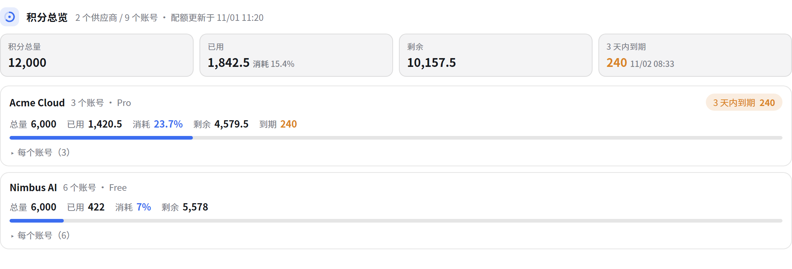

# magpie-quota-glance

A magpie plugin that puts every account's credits in one place.

It adds a panel to **Usage › Overview** that aggregates, per provider, all of that
provider's accounts: total credits, credits spent with the spent share, credits left,
and **how much lapses within the next 3 days** (with the exact lapse time). The same
panel also appears in each provider's editor, scoped to that provider.

Ships as a page-less panel plugin: it never touches your requests, never calls a vendor
API, and reads nothing from magpie (`magpie plugin` reports `reads nothing`).



<sub>Screenshot taken with made-up accounts and numbers.</sub>

## What the panel shows

| Row | Meaning |
| --- | --- |
| 积分总量 | Sum of each account's credit window `limit` under the provider |
| 已用 / 消耗 | Sum of used credits (`amount`) and its share of the total |
| 剩余 | Total minus spent |
| 3 天内到期 | Credits whose batch lapses within 72 h (`runsOutAt`), plus windows that reset within 72 h |

Per account: plan, spent / limit, spent share, per-window bars, reset time, and the
lapsing amount with its timestamp. Accounts whose quota cannot be read (401, no plan,
not subscribed) are listed as unreadable instead of being counted as zero.

## Install

```bash
magpie plugin add "<path to this folder>"
magpie plugin            # expect: panels  Credits on usage, Credits on provider (reads nothing)
```

Then open **Usage › Overview** and scroll to the bottom. See [INSTALL.md](INSTALL.md)
for the detailed steps, uninstall, and troubleshooting (中文).

## How it works

magpie's plugin pages run in a sandbox that can only read `usage:summary` and
`providers:list`, with `connect-src 'none'` — so a page cannot see per-account credits.
The plugin host (Bun, `index.mjs`) therefore reads magpie's own quota cache
(`~/.config/magpie/quotas.json`, the same `auth.usage` results the built-in cards draw)
and writes an aggregated snapshot to `panel/live.js`; the panel picks it up with
`<script src="live.js?v=…">`, which the sandbox does allow.

```
quotas.json ──► index.mjs (aggregate) ──► panel/live.js ──► panel (every 3 s)
```

Aggregation rules:

- Only total windows count: windows marked `aside` (or `spans[i].aside`) are breakdowns
  of the same credits (e.g. CodeArts' 基础积分包 / 赠送积分包) and are skipped.
- `used` is the percentage, `amount` is the spent credits, `limit` is the cap.
- Lapsing credits use `runsOutAt` (when the batch is written off) first, then
  `resetsAt` (period reset); `min(runsOut, remaining)` is used when both exist.
- `runsOutAt` alone is not treated as an expiry prediction — only as a batch lapse.

## Limitations

- The panel can only be appended to the end of the built-in Overview: magpie's plugin
  UI exposes `panels` slots only at the end of a page (or the provider editor), and
  `page.replaces` would take over the whole Usage page and drop the request ledger and
  the context pane. This plugin deliberately stays a panel.
- Freshness follows magpie's own quota refresh interval (minutes), not real time.

## Files

```
package.json      manifest (magpie.panels, magpie.icon)
index.mjs         host side: read quotas.json, aggregate, write panel/live.js
panel/quota.html  panel page (sandboxed frame)
panel/quota.css   panel styles, themed through --magpie-* tokens
panel/quota.js    panel renderer; the title mark is inline SVG
icon.svg          plugin icon source (embedded as a data URI in the manifest)
panel/live.js     generated at runtime, not committed
```

## License

MIT
